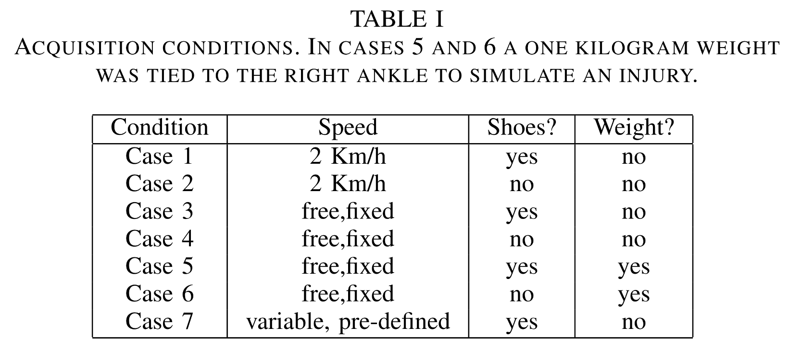
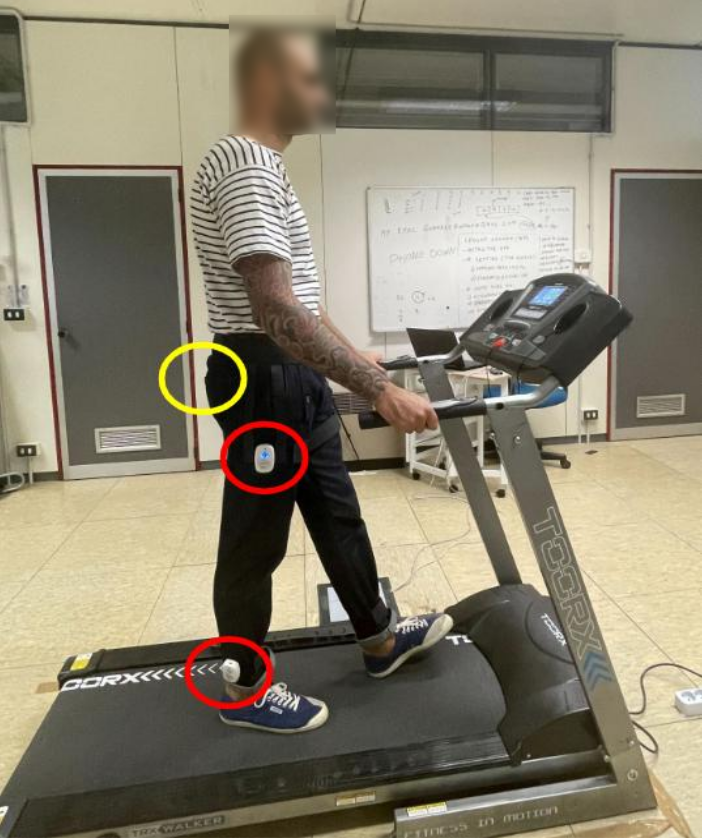
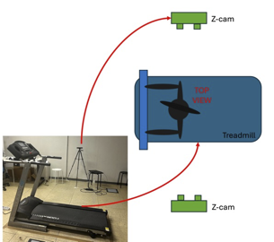

<p align="center">
  
</p>

## The MARCH Dataset: Multi-modal Learning for Gait-Based Human Analysis and Authentication

### Description and Motivations

The MARCH dataset is a multimodal dataset for studying gait-based human analysis and authentication. The MARCH project includes inertial and visual data; this repository currently ships the synchronized inertial CSV data together with loading and visualization utilities.

The dataset contains 50 gender-balanced participants (26 males and 24 females), aged 26.8 +/- 2.9 years. Each participant performed 7 treadmill walking trials of 5 minutes each in an indoor environment.

During the first two trials, the treadmill speed was fixed at 2 km/h. In the third and fourth trials, participants chose a comfortable walking speed. In the fifth and sixth trials, the speed remained user-selected, but a one-kilogram weight was fastened to the participant's left ankle to simulate an injury. The seventh trial followed a pre-programmed speed profile. Every 30 seconds, the velocity shifted between a minimum of 2 km/h and a maximum of 5 km/h according to the following sequence (in km/h): `(2, 4, 3, 4, 3, 5, 4, 2, 5, 3)`.

All even-numbered trials were conducted barefoot, while odd-numbered trials were performed with shoes. These conditions are summarized in the following table.

<p align="center">
  
</p>

Each participant wore five sensors: four IMUs and one smartphone. Two IMUs were secured to the exterior of both ankles, while the remaining two were fastened to the exterior middle section of both thighs using Velcro straps. When the participant stood still, the IMUs were oriented with the x-axis parallel to the leg and pointing downward, the z-axis parallel to the ground and pointing toward the inner part of the body, and the y-axis oriented according to the left-hand rule. 

The Smartphone was placed in the back-left trouser pocket with the y-axis perpendicular to the ground, the z-axis pointing toward the body, and the x-axis oriented according to the right-hand rule.

The figure illustrates the IMU positions (red circles), the Smartphone placement (yellow circle) and the treadmill used.

<p align="center">
  
</p>

Simultaneously, two ZED cameras, positioned on opposite sides of the participant, recorded video. A 10-second example clip from the second ZED camera is available. The participant shown in the video has been anonymized for privacy.

The figure shows the positions of the two ZED cameras during data acquisition.

<p align="center">
  
</p>


Timestamps were collected for all sensors to simplify synchronization across devices. In total, the dataset contains 29.16 hours of data per sensor.

### Getting Started

Clone the repository and install the dependencies. Python 3.8+ is recommended.

```bash
git clone https://github.com/Malga-Vision/MARCH.git
cd MARCH
python3 -m pip install -r requirements.txt
```

### Loading Data

From the repository root, enter the data-loading directory and run the script:

```bash
cd code/Data_loading
python3 data_upload_numpy.py
```

The script interactively prompts for users, cases, tool, and sensor IDs. Example session that loads IMU RA and IMU LA of user 0, case 1:

```text
Inserire user (or 'all'): 0
Inserire case (or 'all'): 1
Inserire tool (all, IMU, Smartphone): IMU
Quali IMUs (es. RT RA LT LA): RA LA
```

To bypass the prompts, call `get_selection_config(...)` and `variable_selection_numpy(...)` programmatically with the same arguments.

### Visualizing IMU Signals

From the repository root, enter the visualization directory and run the script:

```bash
cd code/Data_visualisation
python3 data_visualisation.py
```

By default, the script reads `data/user_00_sync/case_1`, compares IMU RA and IMU LA, and writes `plot.png` next to the script.

### Segmenting Data

From the repository root, enter the segmentation directory and run the script:

```bash
cd code/Data_segmentation
python3 data_segmentation.py
```

By default, each cycle is resampled to 100 samples. Use `--samples` to choose a
different length, for example `--samples 200`.

To keep every segmented cycle at its original length, disable resampling:

```bash
python3 data_segmentation.py --no-resample
```

In this mode, cycles are aligned by sample index for averaging. Shorter cycles are
padded internally, so each point of the average uses the cycles available at that
sample index without resampling the original signals.

To save the segmentation plot without opening the plot window, run:

```bash
python3 data_segmentation.py --no-show
```

### Technical Information: NumPy Data Structure

The `User_Case_Dataset_NumPy` class parses the dataset directory tree:

```text
root_dir / user / case / instrument / data_file
```

Calling the dataset with `dataset[idx]` returns:

```python
(data_array, user_label, case_label, tool_label, data_id)
```

`data_array` is a 2D NumPy array where rows are time samples and columns are:

| Column | Name | Description |
| --- | --- | --- |
| 0 | `timestamp_ns` | System timestamp in nanoseconds |
| 1 | `wx` | Angular velocity X |
| 2 | `wy` | Angular velocity Y |
| 3 | `wz` | Angular velocity Z |
| 4 | `ax` | Linear acceleration X |
| 5 | `ay` | Linear acceleration Y |
| 6 | `az` | Linear acceleration Z |
| 7 | `gx` | Gravity X |
| 8 | `gy` | Gravity Y |
| 9 | `gz` | Gravity Z |
| 10 | `time_ms_loc` | Local time in milliseconds, used for synchronized plotting |

Label encodings:

| Label | Values | Description |
| --- | --- | --- |
| `user_label` | `0` to `49` | Participant ID |
| `case_label` | `1` to `7` | Gait scenario / trial condition |
| `tool_label` | `0` or `1` | `0 = IMUs`, `1 = Smartphone` |
| `data_id` | `RT RA LT LA` for IMUs, `0` for Smartphone | Sensor location or device ID |

### Available Functions

`get_selection_config(user_input, case_input, tool_input, id_input)` parses selection criteria. If arguments are omitted, it prompts through the console.

- Users: `'all'` for users `0-49`, or specific IDs such as `1 2 5`.
- Cases: `'all'` for cases `1-7`, or specific cases such as `1 3`.
- Tools: `'all'`, `'IMU'`, or `'Smartphone'`.
- IDs: IMU IDs such as `RT RA LT LA`; Smartphone uses ID `0`.

`variable_selection_numpy(dataset, users, cases, tools, ids)` returns concatenated NumPy arrays:

```python
(data, user_labels, case_labels, tool_labels, ids)
```

### Reference

If you use this dataset in a publication, please cite the associated MARCH paper or data record.

Mendeley Data DOI/link: to be added before public release.
